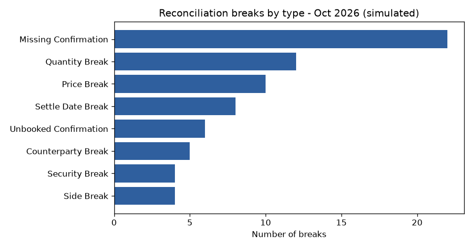
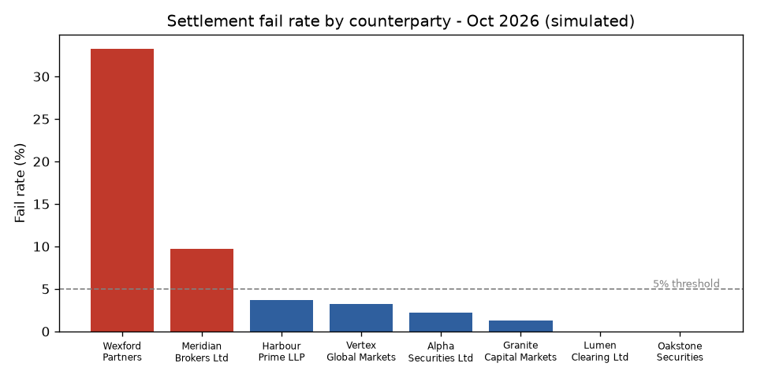
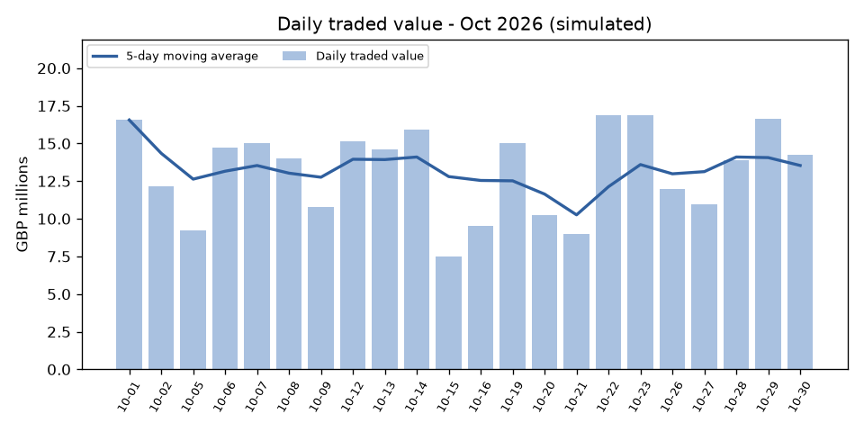

# Trade Reconciliation & Data Quality in SQL

A SQL project that reconciles a month of equity trades the way a bank's operations or data team would. It matches our bookings against broker confirmations, finds and ages the breaks, scores data quality, tracks settlement fails, and reports positions and counterparty exposure in GBP.

> **All data is simulated.** Securities, counterparties, ISINs, LEIs, prices and trades are invented. Known issues are planted on purpose, so every SQL check can be tested against an answer key.



## The business problem

When a trader books a trade, the broker sends back a confirmation. The two records should agree on security, counterparty, side, quantity, price and settlement date. If they don't (a **break**), the trade can fail to settle. That costs the bank fines and funding, and it creates risk. Operations teams reconcile every day, fix breaks before the settlement date and escalate old, high-value ones.

This project automates that process for **1,222 trades** in October 2026 across three markets:

| Market | Currency | Settlement cycle |
|---|---|---|
| LSE (UK) | GBP | T+2 |
| NYSE (US) | USD | T+1 |
| XETRA (Germany) | EUR | T+2 |

## Data model

| Table | What it holds |
|---|---|
| `trades` | Front-office bookings (our view) |
| `confirmations` | Broker confirmations (their view) |
| `settlements` | Settled or failed, with fail reason |
| `securities` | Security master: ISIN, market, currency, settlement cycle |
| `counterparties` | Counterparty master: LEI, active flag |
| `prices`, `fx_rates` | Daily closing prices and FX rates to GBP |
| `calendar` | Business days, used for T+1/T+2 and break ageing |
| `opening_positions` | Positions at the start of the month |

The view `v_recon` (in `sql/00_schema.sql`) does the core match with a **FULL OUTER JOIN**, so it keeps trades with no confirmation *and* confirmations with no trade. Each record gets one status: `MATCHED`, `MISSING_CONFIRMATION`, `UNBOOKED_CONFIRMATION`, `SECURITY_BREAK`, `COUNTERPARTY_BREAK`, `SIDE_BREAK`, `QUANTITY_BREAK`, `PRICE_BREAK` (outside a 0.05% tolerance) or `SETTLE_DATE_BREAK`.

## The queries

| File | Question it answers | SQL used |
|---|---|---|
| `01_data_quality.sql` | How complete, valid, unique, timely and accurate is the booking data? | `UNION ALL` scorecard, subqueries, self-join on calendar |
| `02_reconciliation_breaks.sql` | Which trades don't match the broker, and how? | View built on `FULL OUTER JOIN`, `CASE` |
| `03_break_summary.sql` | How many breaks of each type, and how much value is at stake? | `GROUP BY`, `SUM() OVER ()` |
| `04_break_ageing.sql` | Which breaks are oldest and largest, and need escalating? | CTE, business-day ageing, `RANK()` |
| `05_settlement_fails.sql` | Which counterparties fail to settle most often? | Conditional aggregation, `RANK()` |
| `06_positions.sql` | What is the closing position and market value per book? | CTEs, `PARTITION BY` |
| `07_counterparty_exposure.sql` | Are we too concentrated with one counterparty? | Running total `ROWS UNBOUNDED PRECEDING` |
| `08_daily_volume.sql` | How is daily traded value trending? | 5-day moving average, `LAG()` |
| `09_kpi_summary.sql` | One-page KPIs for management | `UNION ALL`, `printf` |

## Key findings

- **94.2% auto-match rate.** 1,157 of 1,228 records matched without manual work.
- **71 open breaks worth about GBP 14.9m.** The largest group is missing broker confirmations (22). Four of these trace back to **duplicate bookings**, which the data-quality check catches independently.
- **18 breaks need escalating** because they are at least 3 business days old and worth GBP 250k or more.
- **Data quality is 99%+ on every check, but 6 of 7 checks still fail.** The failures are: 5 trades with no counterparty, 4 invalid or unknown ISINs, 8 trades booked with the wrong settlement cycle, 4 duplicates, 3 trades with an inactive counterparty, and 1 counterparty with no LEI.
- **Meridian Brokers fails 9.7% of settlements**, against 3.5% overall. They should be reviewed.
- **Alpha Securities is 23.7% of traded value**, above the 20% concentration limit.



### Validation against the answer key

`generate_data.py` prints the planted issues. The SQL finds every one of them, and the 15 trades with tiny rounding differences correctly **match** within tolerance.

| Planted issue | Planted | Found by SQL |
|---|---|---|
| Missing confirmation (18 + 4 duplicates) | 22 | 22 |
| Quantity / price / side breaks | 12 / 10 / 4 | 12 / 10 / 4 |
| Wrong settlement date | 8 | 8 |
| Blank counterparty / bad ISIN | 5 / 4 | 5 / 4 |
| Unbooked broker confirmations | 6 | 6 |
| Duplicates / inactive counterparty | 4 / 3 | 4 / 3 |



## How to run

Needs Python 3 with `matplotlib`. SQLite comes with Python, but you need version 3.39 or later for `FULL OUTER JOIN` (Python 3.12+ includes it).

```bash
pip install matplotlib
python generate_data.py     # create the simulated CSVs in data/
python run_analysis.py      # build trade_recon.db, run all queries, save results/ and charts
```

Each query's output is saved as a CSV in `results/`. You can also open `trade_recon.db` in any SQLite tool (for example DB Browser for SQLite) and run the `.sql` files directly.

## Simplifications

- Business days skip weekends but ignore bank holidays.
- Prices, FX and fails are randomly generated, so the figures show the method, not a real market.
- Positions are calculated from bookings as entered, so a duplicate booking also inflates the position, which is exactly why duplicates matter.

## Author

Aniket Chavan, MSc Computer Science (Ulster University). This builds on my reconciliation work at a corporate transport company, where I matched vendor bills, trip logs and client MIS every month. Here the same discipline is applied to trading data.
[LinkedIn](https://linkedin.com/in/aniketchavan1519) · [GitHub](https://github.com/caniket1519)
